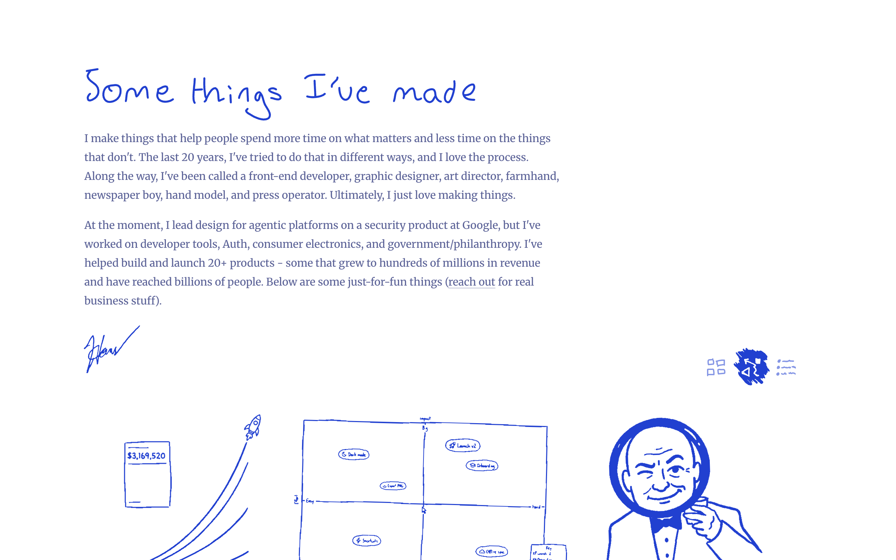
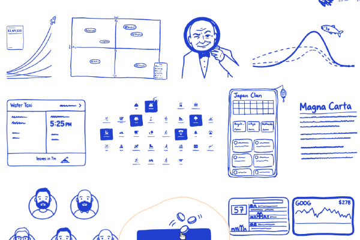
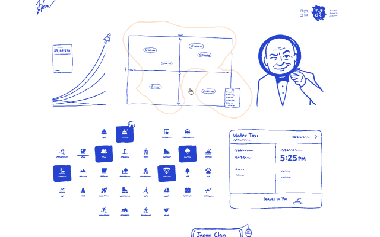
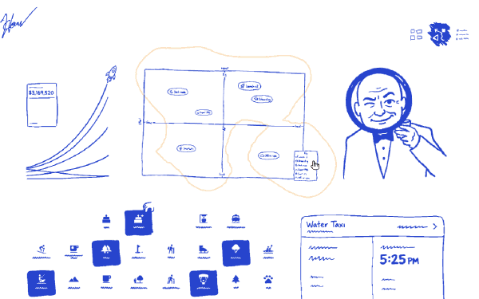
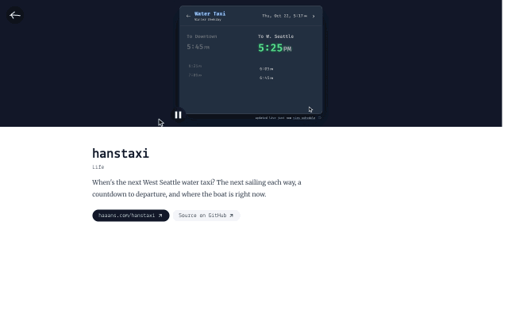

# `things`

A portfolio of things I've made, each one a blue marker drawing that turns into the real thing when you open it.

  
[<kbd> haaans.com/things  </kbd>](https://haaans.com/things)

## Features

<table>
<tr valign="top">
<td width="50%">
<h3>Hover a drawing</h3>

Move across the page and a soft outline traces whichever drawing you're on, so you can tell where one project ends and the next begins.

</td>
<td width="50%">

</td>
</tr>
<tr valign="top">
<td width="50%">

</td>
<td width="50%">
<h3>Open a project</h3>

Click a drawing and the ink washes away to show the real project, running, with a link to try it and its source.

</td>
</tr>
<tr valign="top">
<td width="50%">
<h3>Switch the view</h3>

Three small icons swap the drawings for a grid of screenshots or a plain index you can read down.

</td>
<td width="50%">

</td>
</tr>
<tr valign="top">
<td width="50%">

</td>
<td width="50%">
<h3>Go back</h3>

The arrow returns you to the same spot on the page, right where you left off.

</td>
</tr>
</table>
